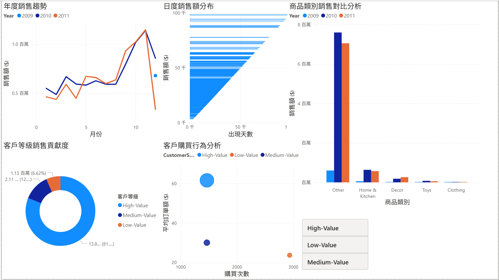
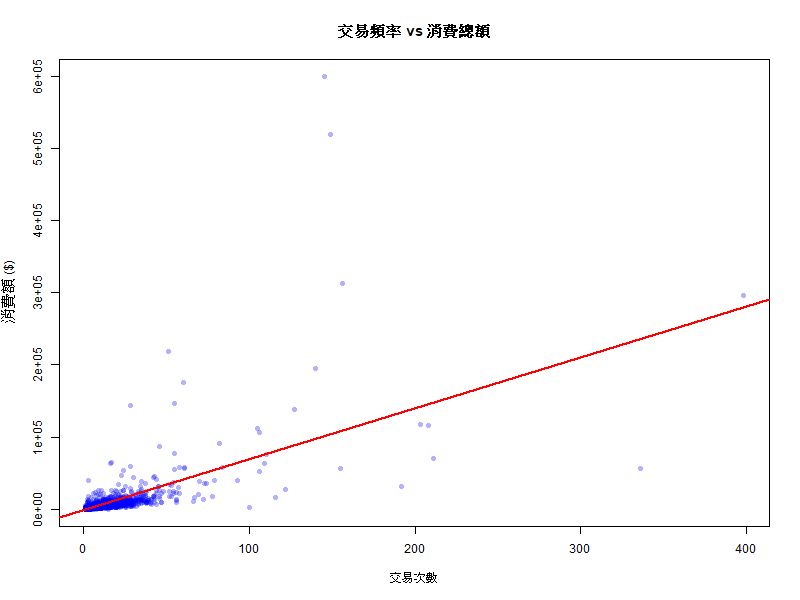
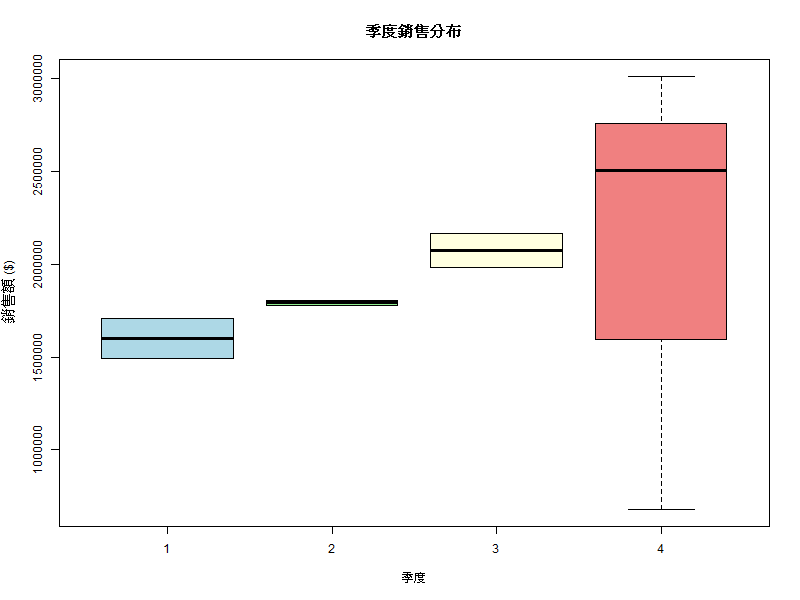
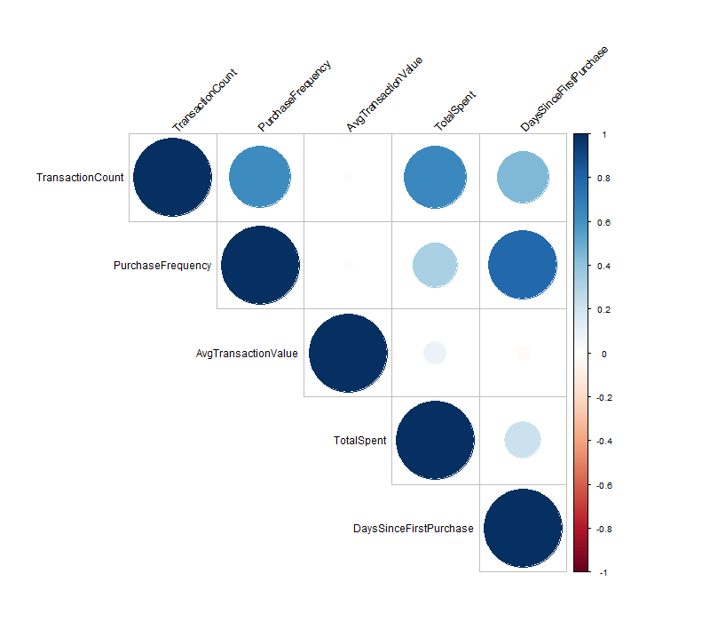
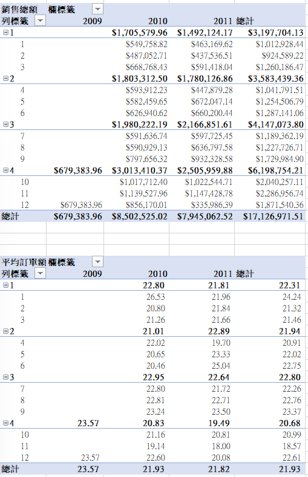
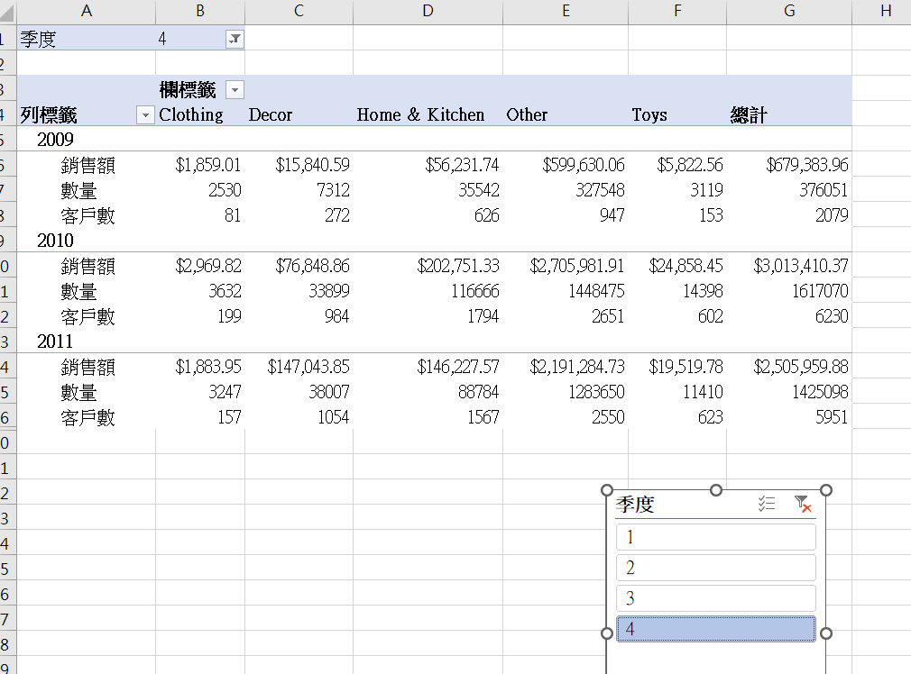

# 電商平台銷售分析：R、Excel 與 Power BI

「大數據分析輕鬆上手」（2026 春季班）課程專題。使用公開的 Online Retail II 資料集，分析一家英國線上零售商在 2009 年 12 月到 2011 年 12 月的交易紀錄。專案用 R 清理資料並做統計檢定，用 Excel 樞紐分析表整理報表，再用 Power BI 做成互動式儀表板。

課程簡報：[slides/ecommerce_sales_analysis.pdf](slides/ecommerce_sales_analysis.pdf)



## 分析流程

| 步驟 | 工具 | 內容 |
|---|---|---|
| 1. 資料清理 | R（dplyr、tidyverse） | 合併兩個年度的工作表，移除缺失值與異常值，建立銷售額、季度等衍生欄位 |
| 2. 資料彙總 | R | 產生日銷售、商品類別、客戶指標三份彙總表 |
| 3. 樞紐分析 | Excel（Power Pivot） | 依年度、季度、月份、商品類別與客戶等級建立樞紐分析表與交叉分析篩選器 |
| 4. 儀表板 | Power BI | 銷售趨勢、日銷售分布、商品類別比較、客戶等級貢獻、客戶購買行為 |
| 5. 統計檢定 | R（stats、corrplot） | 相關分析、迴歸、ANOVA、相關矩陣 |

## 資料清理規則

`R/01_data_cleaning.R` 依序做以下處理：

- 移除沒有 CustomerID、Quantity 或 Price 的資料
- 移除數量或單價小於等於 0 的資料（退貨與調整紀錄）
- 移除數量 ≥ 1,000 或單價 ≥ 10,000 的極端值
- 新增 `SalesAmount = Quantity × Price`，以及日期、月份、季度、星期欄位
- 依消費總額的四分位數把客戶分成 High-Value（前 25%）、Medium-Value、Low-Value 三級

清理後的資料涵蓋 5,871 位客戶、36,888 張發票。

## 統計分析結果

以下數字由 `data/` 裡的彙總表計算而來。

| 分析 | 方法 | 結果 |
|---|---|---|
| 交易次數與消費總額 | Pearson 相關、簡單線性迴歸 | r = 0.64，R² = 0.41，p < 0.001 |
| 商品類別銷售差異 | 單因子 ANOVA | F = 70.9，p < 0.001 |
| 季度銷售差異 | 單因子 ANOVA | F = 0.19，p = 0.90，未達顯著 |
| 客戶等級平均訂單額 | 單因子 ANOVA | F = 15.1，p < 0.001 |
| 客戶指標關聯 | 相關矩陣 | 購買月份數與首購至今天數的相關最高（r = 0.78） |

**觀察**

- High-Value 客戶佔客戶數 25%，貢獻約 81% 的營收。
- 第 3、4 季的季節指數約 1.09，高於第 1 季的 0.84，但 ANOVA 沒有達到顯著。季度樣本只有 9 個，而且 2009 年第 4 季和 2011 年第 4 季都不是完整的一季，所以這個結果的解釋力有限。

**限制**

- 商品類別是用商品名稱的關鍵字分類，大部分商品被歸到 Other，類別之間的比較主要反映分類方式，不一定代表真實的品類差異。
- 交易次數與消費總額都不符合常態分布（Shapiro-Wilk 檢定 p < 0.05），Pearson 相關的結果要保守解讀。

<table>
<tr>
<td><br>交易次數與消費總額</td>
<td><br>季度銷售分布</td>
<td><br>客戶指標相關矩陣</td>
</tr>
</table>

## Excel 樞紐分析

<table>
<tr>
<td><br>各年度季度、月份銷售額</td>
<td><br>商品類別樞紐表與季度篩選器</td>
</tr>
</table>

## 專案結構

```
├── R/
│   ├── 01_data_cleaning.R          資料清理與彙總
│   └── 02_statistical_analysis.R   統計檢定與圖表
├── data/
│   ├── daily_sales.csv             日銷售彙總（604 天）
│   ├── product_category.csv        商品類別 × 季度彙總
│   └── customer_metrics.csv        客戶指標（5,871 位客戶）
├── excel/online_retail_analysis.xlsx      樞紐分析表
├── powerbi/online_retail_dashboard.pbix   Power BI 儀表板
├── images/                         R、Excel、Power BI 圖表截圖
└── slides/ecommerce_sales_analysis.pdf     課程簡報
```

## 如何執行

1. 從 [UCI Machine Learning Repository](https://archive.ics.uci.edu/dataset/502/online+retail+ii) 或 [Kaggle](https://www.kaggle.com/datasets/ylchang/online-retail-data) 下載 `online_retail_II.xlsx`，放到 `data/raw/`。原始檔約 45 MB，沒有放進這個 repo。
2. 在 R 中把工作目錄設為專案根目錄，安裝 `readxl`、`tidyverse`、`fBasics`、`corrplot`。
3. 依序執行 `R/01_data_cleaning.R` 和 `R/02_statistical_analysis.R`。
4. 用 Power BI Desktop 開啟 `powerbi/online_retail_dashboard.pbix`。

## 資料來源

Chen, D. (2019). *Online Retail II* [Dataset]. UCI Machine Learning Repository. https://doi.org/10.24432/C5CG6D
